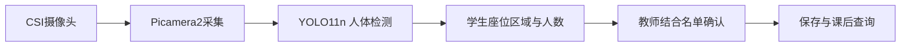

# 树莓派视觉考勤终端

面向高校多媒体教室的视觉人数核验辅助：摄像头采集学生座位区域，显示可见人数与时间，由教师对照名单确认后保存考勤结果，用于课后查询与教学统计。

**技术栈**：Python · YOLO11n · MobileNetV4 · BiFormer · NCNN / INT8 · 树莓派5 · Picamera2 / libcamera · OpenCV · gpiozero。

本仓库公开项目架构、课堂使用流程、已有相机与NCNN人脸检测分支源码、外设控制脚本及数据资料。课堂人体计数流程和人脸检测分支分开说明；公开包不包含完整课堂应用、最终训练权重或学生图像。

## 项目工作

- **端侧部署**：围绕YOLO11n人脸检测分支，结合轻量骨干、注意力模块、NCNN导出和INT8量化组织部署。
- **采集集成**：树莓派5连接CSI摄像头与显示设备，摄像头由IMX219迭代至IMX708；Picamera2/libcamera提供1280×720采集，OpenCV显示、拍照、录像并保存标注结果。
- **数据排障**：针对图片与标签不配对导致的训练中断编写清洗脚本；以清晰本地图片和实时相机输入对照定位采集问题。
- **课堂流程**：按学生座位区域筛选YOLO11n人体检测结果，排除讲台教师；教师结合班级名单确认个人考勤状态，减少重复清点工作。

## 端到端流程

## 仓库内容

| 文件 | 内容 |
| --- | --- |
| [src/pi5/camera_display.py](src/pi5/camera_display.py) | 已有采集、显示、拍照与录像脚本 |
| [src/pi5/face_detect.py](src/pi5/face_detect.py) | 已有SCRFD/NCNN人脸检测分支，支持相机与本地图片模式 |
| [src/pi5/play_buzzer.py](src/pi5/play_buzzer.py) | 独立gpiozero蜂鸣器音符控制 |
| [架构说明](docs/ARCHITECTURE.md) | 采集、推理、人工确认与记录的职责 |
| [使用说明](docs/USAGE.md) | 原有脚本入口、模型文件与操作方式 |
| [分支与数据说明](docs/DATA-AND-VERSIONS.md) | 人脸/人体分支、数据统计和版本口径 |
| [既有公开数据记录](docs/DATA-INSPECTION.md) | 已发布资料与来源核对 |

三份`src/pi5/`文件从已有材料逐字节复制，未在本次发布中执行或修改。对应SHA256见[source-manifest.json](source-manifest.json)。

## 结果与使用边界

已有face数据静态统计：train 13,386张、val 3,347张，合计16,733张、51,846个face框。它说明所读数据快照的规模，不是课堂人数、模型精度或当前公开数据量。数据图像、录像和模型权重不随本仓库分发。

人脸检测框不代表身份识别；遮挡、离席和重叠由教师结合画面与名单核对。独立蜂鸣器脚本不表示已经与考勤状态联动。

源代码和文档沿用项目[MIT许可](LICENSE)，第三方依赖和模型分别遵循其上游许可，见[第三方说明](THIRD_PARTY_NOTICES.md)。
