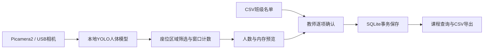

# 架构与版本

应用面向树莓派5与CSI摄像头，也可连接USB相机。`VisionWorker` 独占相机和模型。检测框按底边中心是否位于归一化座位区域内筛选，再对最近若干帧人数取中位数。`LiveState` 保存最新观察值、时间、状态和一张JPEG预览，HTTP线程读取其快照。程序只在内存中保留预览，不把帧写入数据库。

名单是课程创建时的快照，初始状态均为 `pending`。教师确认完整名单后，存储层在同一事务中写入个人状态、确认时间及当前有效视觉人数。`revision` 和草稿状态共同约束确认，避免并发或重复提交覆盖。已确认记录保留原值，CSV导出不修改记录。

视觉模块失败时，人数为空，错误进入服务日志与界面。教师仍可完成名单确认。可见人数仅对应相机视野与设定区域，不能由检测框推断具体学生身份。

`src/pi5/face_detect.py` 是原有SCRFD人脸检测分支；新增 `attendance/vision.py` 使用人体类别模型。原有 `camera_display.py` 保留IMX219窗口名称，后续硬件经历包括IMX708。人脸训练、轻量化/量化与课堂人体计数的材料分别记录，见[版本说明](DATA-AND-VERSIONS.md)。
